<picture>
<source media="(max-width:600px) and (prefers-reduced-motion:reduce)" srcset="assets/profile-hero-mobile-still.svg">
<source media="(prefers-reduced-motion:reduce)" srcset="assets/profile-hero-still.svg">
<source media="(max-width:600px)" srcset="assets/profile-hero-mobile.svg">
</picture>
I build AI systems for <strong>document intelligence, medical imaging and intelligent agents.</strong>

  
  
  

<h2></h2><ul><li>B.Eng. in Artificial Intelligence (Honours) at <strong>Xiamen University Malaysia</strong></li><li><strong>Thesis: CPS-SemiSAM+</strong></li></ul><h2></h2>
<table><thead><tr><th scope="col">Project</th><th scope="col">What it does</th><th scope="col">Tech stack</th></tr></thead><tbody><tr><th scope="row"><strong>Thesis: CPS-SemiSAM+</strong> Repository coming soon</th><td>Studies 3D segmentation with fewer labelled scans using SAM-assisted supervision and counterfactual prompt stability.</td><td>Python · PyTorch · SAM-Med3D · 3D U-Net</td></tr><tr><th scope="row"><a href="https://github.com/nigelcheong1/docintel-ai"><strong>DocIntel AI</strong></a></th><td>Turns PDFs and images into cited answers, summaries and study material with page-level source previews.</td><td>Python · TypeScript · Next.js · FastAPI · PostgreSQL · pgvector · Tesseract</td></tr><tr><th scope="row"><a href="https://github.com/deettoh/halal-supplier-control"><strong>Loupe</strong></a></th><td>Checks ingredient labels against masterlists and certificates, then routes mismatches or expired records for supervisor review.</td><td>React · Vite · Tailwind CSS · Python · FastAPI · PostgreSQL · Qwen3-VL · RunPod</td></tr><tr><th scope="row"><a href="https://github.com/nigelcheong1/dpickleball-rl-agent"><strong>dPickleball</strong></a> <strong>3rd / 13 teams</strong></th><td>Trains a camera-based paddle agent using PPO, simulation, Unity fine-tuning and self-play.</td><td>Python · PyTorch · OpenCV · Stable-Baselines3 · Gymnasium · Unity ML-Agents</td></tr><tr><th scope="row"><a href="https://github.com/nigelcheong1/skin-lesion-classification"><strong>Skin-Lesion Classification</strong></a></th><td>Compares CNN and KAN–Vision Transformer models for 14-class skin-condition classification.</td><td>Python · PyTorch · torchvision · timm · OpenCV · scikit-learn · Jupyter</td></tr></tbody></table>
<h2></h2>

<strong>CPS-SemiSAM+</strong> — semi-supervised 3D medical image segmentation.

<ul><li><strong>Problem:</strong> learning to segment 3D medical images with limited labelled data.</li><li><strong>Approach:</strong> counterfactual prompt stability to refine SAM-assisted pseudo-label supervision.</li><li><strong>Status:</strong> thesis research; repository coming soon.</li></ul>
<picture>
<source media="(max-width:600px) and (prefers-reduced-motion:reduce)" srcset="assets/arcade-research-room-mobile-still.svg">
<source media="(prefers-reduced-motion:reduce)" srcset="assets/arcade-research-room-still.svg">
<source media="(max-width:600px)" srcset="assets/arcade-research-room-mobile.svg">

</picture>
<code>3D Medical Imaging (MRI)</code> <code>Semi-Supervised Learning</code> <code>Foundation Models</code>
<h2></h2><table>
<tbody>
<tr><th scope="row">Languages</th><td>  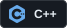 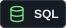 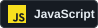</td></tr>
<tr><th scope="row">AI / Machine Learning</th><td>     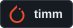</td></tr>
<tr><th scope="row">Computer Vision &amp; Medical AI</th><td>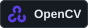  </td></tr>
<tr><th scope="row">Reinforcement Learning</th><td>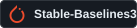 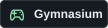 </td></tr>
<tr><th scope="row">Data &amp; Analytics</th><td> 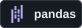 </td></tr>
<tr><th scope="row">Backend &amp; Apps</th><td> 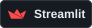</td></tr>
<tr><th scope="row">Databases &amp; Vector Search</th><td>   </td></tr>
<tr><th scope="row">Dev Tools &amp; Containers</th><td>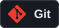  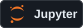 </td></tr>
<tr><th scope="row">Deployment &amp; Hosting</th><td>  </td></tr>
</tbody>
</table><h2></h2>
<code>Computer Vision</code> <code>Medical Imaging</code> <code>Reinforcement Learning</code> <code>Foundation Models</code> <code>Semi-Supervised Learning</code> <code>Document Intelligence</code> 
<h2></h2>
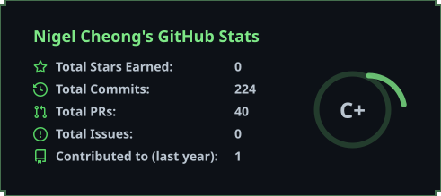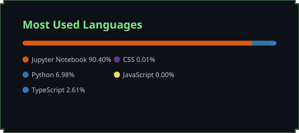

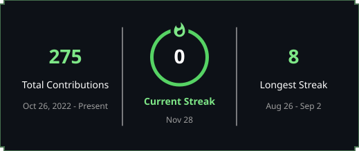
<picture>
<source media="(max-width:600px) and (prefers-reduced-motion:reduce)" srcset="assets/pixel-calendar-mobile-still.svg">
<source media="(prefers-reduced-motion:reduce)" srcset="assets/pixel-calendar-still.svg">
<source media="(max-width:600px)" srcset="assets/pixel-calendar-mobile.svg">
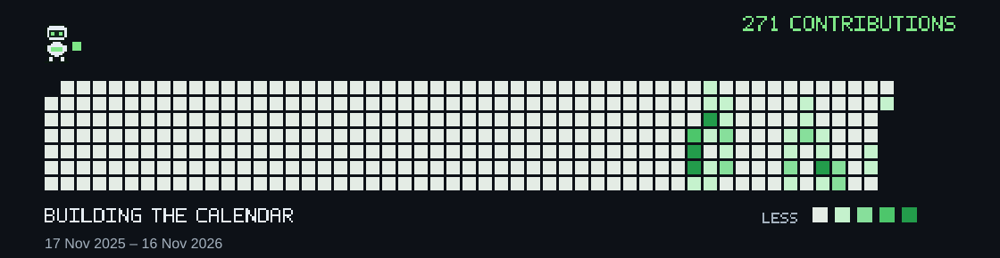
</picture>

Interested in AI research or building useful systems?

