<picture>
  <source media="(max-width: 600px) and (prefers-reduced-motion: reduce)" srcset="./assets/header-mobile-still.svg" />
  <source media="(prefers-reduced-motion: reduce)" srcset="./assets/header-still.svg" />
  <source media="(max-width: 600px)" srcset="./assets/header-mobile.svg" />
  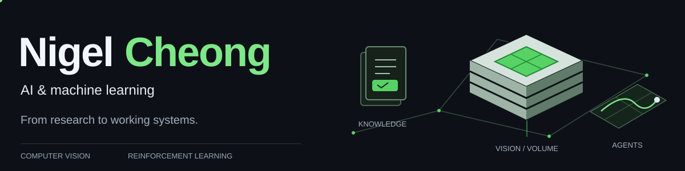
</picture>

I build **AI systems that connect research with practical use**—from document intelligence and reinforcement-learning agents to semi-supervised 3D medical image segmentation.

  
  
  

## About

- B.Eng. in Artificial Intelligence (Honours) at **Xiamen University Malaysia**
- **Thesis: CPS-SemiSAM+** — semi-supervised 3D medical image segmentation with SAM-assisted prompt-stability supervision.
- **Interests:** computer vision, medical AI, reinforcement learning, intelligent agents, and document intelligence.

## Featured Projects

| Project | What it does | Tech stack |
| --- | --- | --- |
| **Thesis: CPS-SemiSAM+** Repository coming soon 3D medical image segmentation | Researches semi-supervised segmentation with limited labelled data, using counterfactual prompt stability to refine SAM-assisted pseudo-label supervision. | `Python` `PyTorch` `SAM-Med3D` `3D U-Net` |
| [DocIntel AI](https://github.com/nigelcheong1/docintel-ai) Document intelligence workspace | Extracts text from PDFs and images, retrieves relevant evidence, and provides cited answers, summaries, and study material with page-level source previews. | `Python` `TypeScript` `Next.js` `FastAPI` `PostgreSQL` `pgvector` `Tesseract` |
| [Loupe](https://github.com/deettoh/halal-supplier-control) Halal supplier control workspace | Checks photographed ingredient labels against masterlist and certificate records, flags mismatches or expiry, and routes flagged deliveries to a supervisor. | `React` `Vite` `Tailwind CSS` `Python` `FastAPI` `PostgreSQL` `Qwen3-VL` `RunPod` |
| [dPickleball](https://github.com/nigelcheong1/dpickleball-rl-agent) Reinforcement-learning game agent | Controls a paddle from camera observations using a calibrated simulator, PPO training, Unity fine-tuning, and self-play. Placed 3rd out of 13 teams. | `Python` `PyTorch` `OpenCV` `Stable-Baselines3` `Gymnasium` `Unity ML-Agents` |
| [Skin-Lesion Classification](https://github.com/nigelcheong1/skin-lesion-classification) Computer vision model comparison | Compares custom CNNs with KAN–Vision Transformer hybrids for 14-class skin-condition classification, including preprocessing and evaluation. | `Python` `PyTorch` `torchvision` `timm` `OpenCV` `scikit-learn` `Jupyter` |

## Current Research

**Medical image segmentation with limited labels.** My thesis explores semi-supervised 3D imaging and how foundation models such as SAM can support more reliable, data-efficient segmentation.

<picture>
  <source media="(max-width: 600px) and (prefers-reduced-motion: reduce)" srcset="./assets/research-mobile-still.svg" />
  <source media="(prefers-reduced-motion: reduce)" srcset="./assets/research-still.svg" />
  <source media="(max-width: 600px)" srcset="./assets/research-mobile.svg" />
  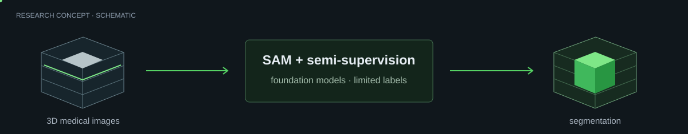
</picture>

Research concept diagram; not an experimental result.

**Current focus areas:** Medical Image Segmentation · Semi-Supervised Learning · Foundation Models · Segment Anything Model (SAM) · 3D Medical Imaging (MRI) · Computer Vision for Healthcare.

## Tech Stack

<table>
<tbody>
<tr><th scope="row">Languages</th><td>  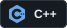 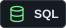 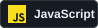</td></tr>
<tr><th scope="row">AI / Machine Learning</th><td>     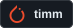</td></tr>
<tr><th scope="row">Computer Vision &amp; Medical AI</th><td>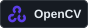  </td></tr>
<tr><th scope="row">Reinforcement Learning</th><td>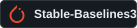 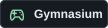 </td></tr>
<tr><th scope="row">Data &amp; Analytics</th><td> 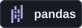 </td></tr>
<tr><th scope="row">Backend &amp; Apps</th><td> 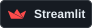</td></tr>
<tr><th scope="row">Databases &amp; Vector Search</th><td>   </td></tr>
<tr><th scope="row">Dev Tools &amp; Containers</th><td>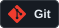  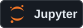 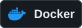</td></tr>
<tr><th scope="row">Deployment &amp; Hosting</th><td>  </td></tr>
</tbody>
</table>

## Areas of Interest

<code>Deep Learning</code> <code>Computer Vision</code> <code>Medical Image Segmentation</code> <code>Medical Computer Vision</code> <code>Reinforcement Learning</code> <code>Foundation Models</code> <code>Semi-Supervised Learning</code> <code>AI Research</code>

 Open the lab notes

**What I am exploring**

- Adapting foundation models to 3D medical segmentation.
- Learning from limited labelled data and useful prompts.
- Simulation, evaluation, and deployment of intelligent agents.

The calendar below uses actual contribution counts and a daily GitHub Actions update. Its columns wobble automatically when the robot finishes a featured block.

## GitHub Analytics

  
  

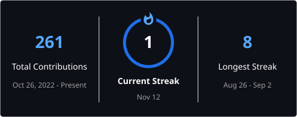

<picture>
  <source media="(prefers-reduced-motion: reduce)" srcset="./assets/robot-builder.png" />
  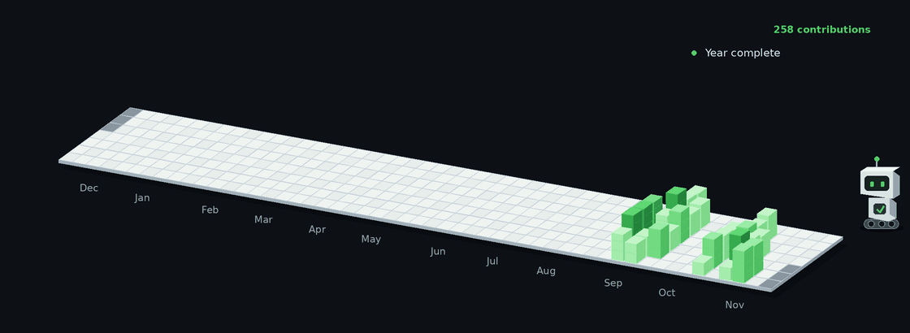
</picture>

---

Interested in AI research or building useful systems?

